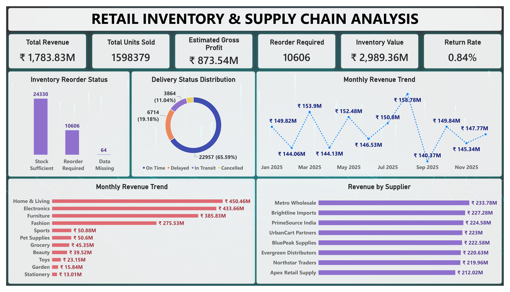

# Retail Inventory & Supply Chain Analysis

## Project Overview
This project analyzes retail sales, inventory, supplier performance, delivery operations, product returns, and sales forecasts using a dataset of 35,000 records and 25 columns.

The goal is to identify business trends, evaluate inventory efficiency, understand supply chain performance, and generate actionable insights through data analysis and an interactive Power BI dashboard.

## Project Objectives
- Analyze total revenue, units sold, and estimated gross profit.
- Identify monthly sales trends and top-performing product categories.
- Evaluate supplier performance and lead times.
- Monitor inventory levels and identify items requiring reorder.
- Analyze delivery status and product return patterns.
- Compare actual sales performance with forecasts.
- Compare sales channels and warehouse performance.

## Tools & Technologies
- **Excel:** Data cleaning and preparation
- **Python:** Data cleaning, analysis, and exploratory data analysis
- **PostgreSQL:** SQL queries and business analysis
- **Power BI:** Interactive dashboard and KPI visualization

## Dashboard Preview

## Key Business Insights
- **Total Revenue:** ₹178.38 Crore
- **Estimated Gross Profit:** ₹87.35 Crore
- **Total Units Sold:** 1,598,379
- **Total Returned Units:** 13,443
- **Overall Unit Return Rate:** Approximately 0.84%
- **Highest Revenue Month:** August 2025
- **Top Revenue Category:** Home & Living
- **Highest-Revenue Supplier:** Metro Wholesale
- **Inventory Reorder Required:** 10,606 records
- **On-Time Deliveries:** 65.59%

## Project Files
1. `1_retail_inventory_supply_chain_analysis_data.csv` — Cleaned dataset used for analysis.
2. `2_retail_inventory_supply_chain_analysis_python.ipynb` — Python notebook for data cleaning and exploratory analysis.
3. `3_retail_inventory_supply_chain_analysis_queries.sql` — PostgreSQL queries for business analysis.
4. `4_retail_inventory_supply_chain_analysis_dashboard.pbix` — Interactive Power BI dashboard.
5. `5_retail_inventory_supply_chain_analysis_dashboard_image.png` — Dashboard preview image.
6. `6_retail_inventory_supply_chain_analysis_report.pdf` — Final project analysis report.

## Methodology
1. Cleaned and prepared the dataset in Excel.
2. Performed additional data cleaning and exploratory analysis using Python.
3. Imported the cleaned data into PostgreSQL for SQL-based business analysis.
4. Created an interactive Power BI dashboard to visualize key performance indicators and business trends.
5. Compiled the findings into a final analysis report.

## Conclusion
This project demonstrates an end-to-end data analytics workflow, from data cleaning and exploration to SQL analysis, dashboard development, and business reporting. The findings help evaluate retail performance, inventory management, supplier efficiency, and delivery operations.

## Data Disclaimer
This project uses a synthetic dataset created for educational and portfolio purposes. The results represent analysis of the provided dataset and do not describe the actual performance of any real company.
